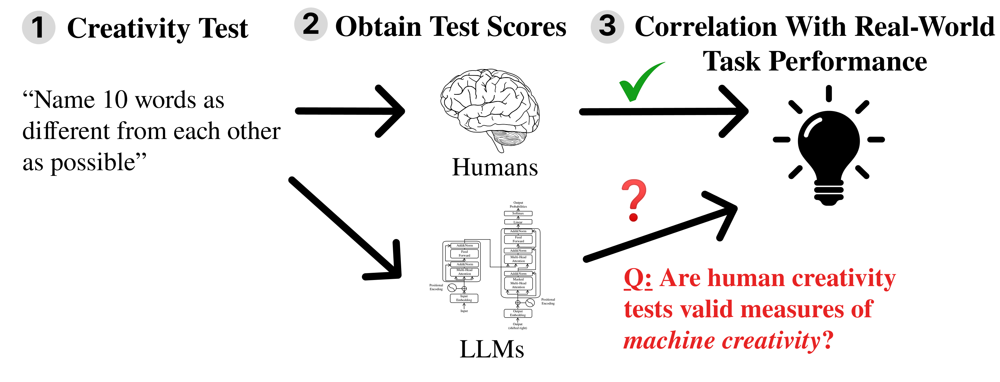

<div align="center">

# Do Semantic Distance Tests *Actually* Predict Creativity in LLMs? Evidence for Jagged Creativity

**Samuel Schapiro, Alexi Gladstone, Jonah Black, Heng Ji**

[](LICENSE)
[](https://www.python.org/downloads/)
[](https://openreview.net/forum?id=VflIpUsCvC)
[](https://schapiro.ai/semantic-distance-tests/)



</div>

We give LLMs the semantic distance tests used to measure human creativity, the Divergent Association Task (DAT), the Conditional DAT (CDAT, with its novelty and appropriateness parts) and PACE, plus the Remote Associates Test (RAT). Then we ask whether their scores predict creativity benchmarks in four areas: creative writing, output diversity, combinatorial creativity and scientific ideation. For each test and benchmark we report validity (the correlation with the benchmark) and specificity (the correlation with the part of the benchmark that general ability, measured by MMLU-Pro, does not explain). This repository holds the model responses behind the paper's numbers, the scores computed from them, and the scripts that produce the paper's tables and figures.

## Setup

Python 3.12 or newer.

```bash
pip install -r requirements.txt
# or
uv venv && uv pip install -r requirements.txt
```

Run every command below from the repository root.

## Reproduce the tables and figures (offline)

This step needs no embeddings and no API key. It reads only the saved scores in `data/`.

```bash
python -m src.dat_eval.scripts.neurips_camera_ready   # Table 1, per-temperature table, headline figure, correlation figure
python -m src.dat_eval.scripts.make_greedy_figure     # greedy DAT baseline figure
```

Outputs go to `outputs/`:

| File | What it is |
|---|---|
| `outputs/tables/main_result_body.tex` | Table 1 body (validity and specificity of each test for each benchmark) |
| `outputs/tables/per_temperature_body.tex` | DAT and CDAT at T = 1.0, 1.5, 2.0 (appendix) |
| `outputs/figures/fig_headline.pdf` | headline validity/specificity figure |
| `outputs/figures/fig_benchmark_correlations.pdf` | inter-benchmark and inter-test correlations |
| `outputs/figures/fig_greedy_baseline.pdf` | DAT scores of humans, LLMs and a greedy algorithm |
| `outputs/cells.json` | every table cell with r, p and n |

## Rescore the saved responses (needs embeddings)

The embedding files are not included because of their size. Download them into `resources/`, or set `EMBEDDINGS_DIR` to the folder that holds them:

| Embedding | Used for | Get it |
|---|---|---|
| GloVe 840B 300d | DAT | <https://nlp.stanford.edu/data/glove.840B.300d.zip>, unzip to `glove.840B.300d.txt` |
| FastText crawl-300d-2M | PACE | <https://dl.fbaipublicfiles.com/fasttext/vectors-english/crawl-300d-2M.vec.zip>, unzip to `crawl-300d-2M.vec` |
| Sentence-BERT all-mpnet-base-v2 | CDAT | downloaded on first use by `sentence-transformers` |

The greedy baseline also uses WordNet, which `nltk` downloads on first use. Loading GloVe and FastText needs several GB of RAM.

```bash
python -m src.dat_eval.scripts.cdat_gate                      # CDAT appropriateness gate -> outputs/rescored/cdat_gated_scores.json
python -m src.dat_eval.scripts.rescore_multi_embed            # all tests under all 3 embeddings -> outputs/rescored/multi_embed_scores.json
python -m src.dat_eval.scripts.score_evals configs/score_evals.yaml   # per-temperature scores with each test's own embedding
python -m src.dat_eval.scripts.rescore_greedy_multi_embed     # greedy baseline under all 3 embeddings
python -m src.dat_eval.scripts.run_greedy_baseline configs/greedy_baseline.yaml  # regenerate the greedy word lists
```

These scripts never write into `data/`. They refuse to replace an existing output, so move or rename an old one first.

## Run the tests on models (needs an OpenRouter key)

These commands make paid API calls. Estimate the cost before you run them.

```bash
cp .env.example .env        # then put your OPENROUTER_API_KEY in .env
python -m src.dat_eval.scripts.run_evals configs/run_evals.yaml --debug   # 1 model, a few prompts
python -m src.dat_eval.scripts.run_evals configs/run_evals.yaml           # DAT, CDAT, PACE for all 75 models
python -m src.rat.scripts.run_rat configs/rat_pilot.yaml                  # RAT
python -m src.rat.scripts.run_rat configs/rat_expansion.yaml
```

`run_evals` resumes where it stopped: it skips any response file that already exists. To score new responses, point `upstream_dir` in `configs/score_evals.yaml` at the new folder. Set `LLM_BASE_URL` (and `LLM_API_KEY`) to use any other OpenAI-compatible server instead of OpenRouter.

## Data layout

```
data/
  responses/<model>/          raw responses: dat_responses_t{1-0,1-5,2-0}.json (40 trials each),
                              cdat_responses_t{1-0,1-5,2-0}.json (50 cues each), pace_responses_t0-0.json (50 seeds)
  scores/
    multi_embed_scores.json   per-model DAT, CDAT (gated), CDAT-N, CDAT-A, PACE under GloVe, FastText, SBERT
    cdat_gated_scores.json    appropriateness gate result per model, embedding and temperature
    per_model/<model>/        per-temperature scores with each test's own embedding
  rat/{pilot_v1,expansion_v1}/  RAT raw responses (raw_results.json) and accuracy (summary.json)
  benchmarks/
    benchmarks.json           benchmark scores per model (Arena CW, EQ-Bench CW, Mazur CW v2, Hivemind diversity,
                              NoveltyBench utility, LiveIdeaBench, MMLU-Pro, and a few fields the paper does not use)
    mmlu_pro_raw.json         TIGER-Lab MMLU-Pro leaderboard, used for models missing MMLU-Pro above
    kombine_composite.json    Kombine benchmark scores (combinatorial creativity)
  greedy_baseline/            greedy DAT word lists and their scores under all 3 embeddings
src/
  dat_eval/                   dat.py, cdat.py, pace.py (tests and scoring), llm.py (API client)
  dat_eval/scripts/           run, score, gate and paper-figure scripts
  rat/                        rat.py (items and scoring), scripts/run_rat.py
configs/                      run and scoring configs
```

Model folders use OpenRouter IDs with `/` and `.` replaced, e.g. `openai/gpt-4.1` is `openai_gpt-4-1`.

Notes on the saved data:

- `data/scores/` holds the scores exactly as the paper used them. `outputs/cells.json` matches the paper's numbers.
- For six models (`anthropic_claude-opus-4-6`, `anthropic_claude-sonnet-4-6`, `deepseek_deepseek-chat-v3-0324`, `meta-llama_llama-3-3-70b-instruct`, `microsoft_phi-4`, `openai_gpt-5`), `data/responses/` holds a second set of DAT and CDAT responses. The first runs of Claude Opus 4.6 and Sonnet 4.6 were cut short by a 256-token output cap, so most of their DAT and CDAT answers were empty; the other four were re-run through OpenRouter so all six share one version. Their PACE responses are from the first run, which was complete.
- `cdat_gate.py` writes `cdat_gated_scores.json`; `rescore_multi_embed.py` then writes `multi_embed_scores.json` and `score_evals.py` the per-model scores. Rerunning all three on `data/responses/` reproduces the files in `data/scores/` (exactly for GloVe and FastText, within 1e-5 for Sentence-BERT), so every table and figure follows from the raw responses.

## Citation

```bibtex
@inproceedings{schapiro2026semantic,
  title     = {Do Semantic Distance Tests \emph{Actually} Predict Creativity in LLMs? Evidence for Jagged Creativity},
  author    = {Schapiro, Samuel and Gladstone, Alexi and Black, Jonah and Ji, Heng},
  booktitle = {Advances in Neural Information Processing Systems},
  year      = {2026}
}
```

## License

MIT, see `LICENSE`. Benchmark scores in `data/benchmarks/` come from their public leaderboards and papers; model responses were collected through OpenRouter.
